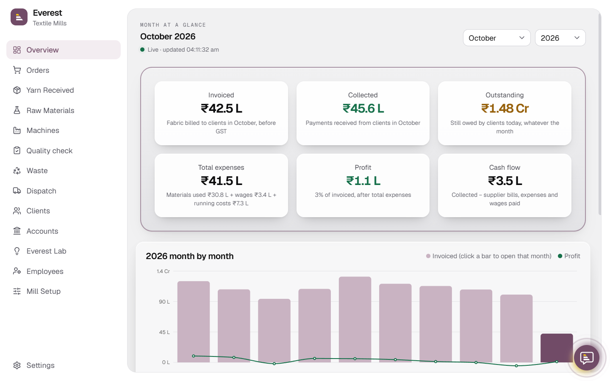

# Everest Textile Mills

Textile Manufacturing System — Odoo Hackathon Finals. One platform for raw material, production floor, quality checks, buyer order tracking, dispatch and month-end costing.

**Live:** https://everest-manufacturing-dashboard.vercel.app (laptop or desktop only; one-click demo logins on the sign-in page)



## Features

- **Orders** — every client order tracked from yarn to invoice, with a public tracking link for the buyer
- **Yarn & raw materials** — stock received, issued and allocated to orders
- **Production floor** — jobs per machine, stage and shift, with daily machine output against capacity
- **Quality check** — pass, rework or reject for every roll
- **Dispatch & accounts** — dispatches, invoices, payments, supplier bills, payroll and GST
- **Owner dashboard** — monthly invoiced, collected, outstanding, expenses, profit and cash flow
- **Everest Lab** — what-if scenarios (rush orders, yarn delays, extra machines) with plain-language recommendations
- **AI assistant** — answers questions about the mill from live data (Google Gemini)
- **Roles** — Owner, Store, Production, QC and Dispatch each see only their own work

## Stack

| Layer | Tech |
|---|---|
| Frontend | React 19 + Vite + TypeScript + Tailwind CSS v4 + shadcn/ui |
| Backend | Node.js + Express + Prisma ORM |
| Database | PostgreSQL (local in dev, [Neon](https://neon.tech) when deployed) |
| AI | Google Gemini |
| Hosting | Frontend and backend → Vercel (`/api` forwarded to the backend project) |

## Local Setup

### Backend
```bash
cd backend
cp .env.example .env
npm install
npm run db             # terminal 1: local Postgres, keep it running
npm run setup          # once: migrate + load the full dataset
npm run dev            # terminal 2: http://localhost:4000
```

### Frontend
```bash
cd web
cp .env.example .env   # VITE_API_URL=http://localhost:4000/api
npm install
npm run dev            # http://localhost:5173
```

## Demo Logins

Password for all: `Password123`

| Role | Email |
|---|---|
| Owner | `owner@everest.dev` |
| Store | `store@everest.dev` |
| Production | `production@everest.dev` |
| QC | `qc@everest.dev` |
| Dispatch | `dispatch@everest.dev` |

## Structure

```
├── backend/   # Express API, Prisma schema, seed
├── web/       # React + Vite frontend
└── docs/      # Problem statement, API reference (api.md)
```
